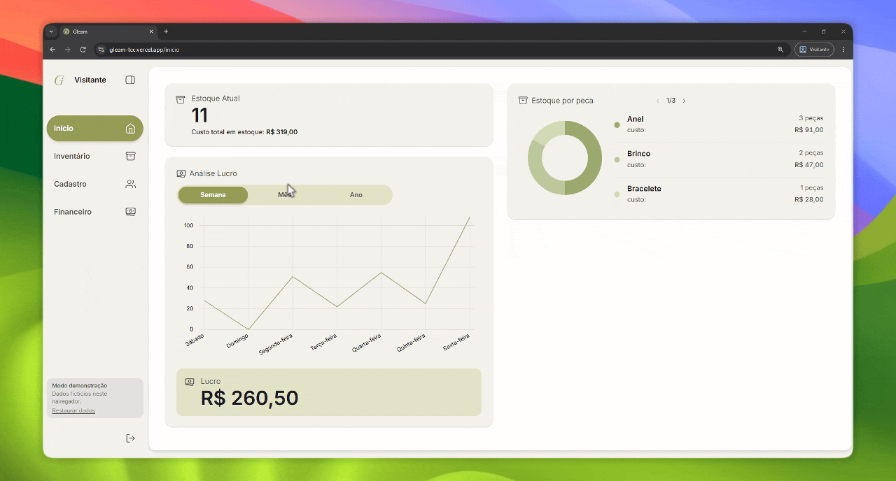

# Gleam

Interface web do Gleam, um sistema de controle de estoque e vendas para joalheria de semijoias. Feito como trabalho de conclusão de curso, em equipe. Este repositório é o frontend (Angular 20); a API em Spring Boot está em [gleam-api](https://github.com/vinisebold/gleam-api).

**Demonstração:** [gleam-tcc.vercel.app](https://gleam-tcc.vercel.app). Roda inteira no navegador, com dados fictícios, sem precisar de backend nem de login.



## O que o sistema faz

- **Início:** estoque atual com o custo total em estoque, análise de lucro por semana, mês e ano (gráfico e total) e estoque por tipo de peça.
- **Inventário:** peças organizadas por fornecedor, com acabamento, preço de custo e data de cadastro. O código da peça é montado a partir do prefixo do fornecedor.
- **Cadastro:** fornecedores (com o prefixo de código de cada categoria) e clientes.
- **Financeiro:** registro de venda com forma de pagamento e parcelas, lista de vendas pendentes com pagamento parcela a parcela, vendas quitadas e cancelamento (a peça volta para o estoque).

As regras de negócio vivem na API. O frontend só as apresenta e valida o que dá para validar antes de enviar.

## Decisões de projeto

**Componentes standalone com rotas carregadas sob demanda.** Cada módulo (`inicio`, `inventario`, `cadastros`, `financeiro`) tem as suas páginas, componentes, modelos e services, e é carregado só quando a rota é aberta. As rotas autenticadas ficam atrás de um `authGuard` e dentro do componente de layout; o `auth.interceptor` envia as credenciais de sessão em toda chamada à API.

**Biblioteca própria de componentes de interface.** Botão, modal, toast, stepper numérico, barra de pesquisa e carrossel ficam em `shared/components`, estilizados com Tailwind CSS 4. Gráficos com `@swimlane/ngx-charts`, máscaras de campo com `imask` e datas com `flatpickr`.

**Modo demonstração.** Em vez de publicar um backend só para quem quiser ver o projeto, a interface sabe funcionar sem ele:

1. Ao iniciar, tenta alcançar a API em `localhost:8080` por cerca de 1,5 s.
2. Se responder, usa a API real, com login pelo Google.
3. Se não responder, entra no modo demonstração: um `HttpInterceptor` (`core/demo`) responde às 22 chamadas da API no próprio navegador, sobre um conjunto de dados fictícios guardado em `localStorage`.

O simulador reproduz as regras do `gleam-api`: código da peça com o prefixo do fornecedor, peça vendida não editável, parcelas, cancelamento que devolve a peça ao estoque e lucro contado só em vendas pagas ou pendentes. O código da demonstração é carregado sob demanda, então quem usa a API real não baixa nada a mais. O aviso de modo demonstração fica discreto na sidebar, com a opção de restaurar os dados.

A detecção não usa `/api/user/me`: sem login, o Spring redireciona para o Google e o navegador não distingue isso de um backend fora do ar.

## Estrutura

```
src/app
├── core/          layout, guards, interceptors, services de autenticação e notificação
│   └── demo/      simulador da API, dados de exemplo e detecção do backend
├── shared/        componentes, diretivas, modelos e utilitários reutilizáveis
├── modules/       inicio, inventario, cadastros, financeiro
└── pages/landing  tela de entrada
```

## Rodando

```bash
npm install
npm start
```

Com o `gleam-api` rodando em `localhost:8080`, a interface usa a API real. Sem ele, cai sozinha na demonstração. Para forçar a demonstração com o backend ligado, abra `http://localhost:4200/?demo=1`.

`npm run build:demo` gera um build estático que sempre usa a demonstração e nunca tenta acessar a API. É o build indicado para publicação estática, como a da Vercel.

Para rodar com a API real é preciso subir o backend, com MySQL e credenciais do Google. Os passos estão no [README do gleam-api](https://github.com/vinisebold/gleam-api#rodando-localmente).

## Testes

```bash
npm test
```

A camada de demonstração (simulador da API e interceptor) tem testes que passam. Os specs de componentes gerados pelo Angular CLI no início do projeto nunca foram completados e ainda falham; é uma pendência conhecida.

## Autoria

Desenvolvido em equipe; veja os [contribuidores](https://github.com/vinisebold/gleam-frontend/graphs/contributors). Fui responsável pela maior parte da interface: layout, módulos de início, inventário e financeiro, componentes compartilhados e o modo demonstração.
